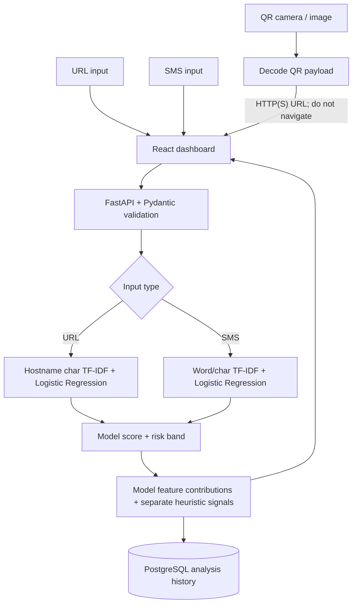

# ThreatGuard

**AI-assisted phishing URL and SMS scam detection — a reproducible cybersecurity ML research prototype.**

ThreatGuard turns a suspicious link or message into a structured risk assessment. It combines lightweight machine-learning classifiers with a FastAPI backend, a React dashboard, PostgreSQL history, QR-code URL extraction, and auditable model releases.

> [!IMPORTANT]
> **Research demonstration, not a production security guarantee.** A low-risk prediction does **not** prove that a URL or message is safe. The active URL classifier is hostname-only, and its independent external-benchmark performance is not sufficient for production use. See [Results](#model-performance) and [Limitations](#limitations-and-security-boundaries).

## What it does

- **URL assessment:** Estimates phishing risk from the normalized **hostname** using character TF-IDF and Logistic Regression.
- **SMS assessment:** Classifies potential scam messages using word and character TF-IDF with Logistic Regression and held-out sigmoid calibration.
- **QR-code scanning:** Decodes a QR code from a camera or image and, for HTTP(S) destinations, sends the decoded URL to the URL detector **without opening the destination**.
- **Risk presentation:** Shows a model score, a risk band, learned feature contributions, separate heuristic indicators, and scope warnings.
- **Analysis history:** Stores results, input type, model version, score, and timestamp in PostgreSQL.
- **Auditable ML:** Retains group-aware splits, data/model/code hashes, test evidence, and a checksum-verified active release.

## Tech stack

| Layer | Tools |
| --- | --- |
| Machine learning | Python, scikit-learn, NumPy, SciPy, TF-IDF, Logistic Regression, joblib |
| API and validation | FastAPI, Pydantic |
| Persistence | PostgreSQL, SQLAlchemy |
| Frontend | React, Vite, Recharts, html5-qrcode |
| Testing and development | pytest, Docker Compose, Git |

## Architecture



The deployed backend loads the release selected by `models/active_release.json`, verifies the release manifest, model bundle, and inference-code SHA-256 hashes, then serves predictions. The QR scanner reuses URL analysis; it does not contain a third classifier.

## Active machine-learning release

**Release:** `reliable-v1` (15 October 2026 repository review)

| Component | Active approach | Evaluation notes |
| --- | --- | --- |
| URL | Hostname character TF-IDF (3–5 grams) + Logistic Regression | **Hostname only:** path, query, redirects, page content, and live reputation are *not* scored |
| SMS | Word TF-IDF (1–2 grams) + character TF-IDF (3–5 grams) + Logistic Regression | Sigmoid calibration fitted on a separate calibration partition |
| Classification policy | Fixed threshold of `0.50` | Output is a model estimate, not a verified real-world probability |

Both models are supervised binary classifiers: `0 = legitimate`; `1 = phishing` for URL or `1 = scam` for SMS. The application maps the model estimate to four risk bands: **LOW** (< 0.20), **MEDIUM** (0.20–< 0.50), **HIGH** (0.50–< 0.80), and **CRITICAL** (>= 0.80).

### Leakage-aware evaluation

The development pipeline saves source hashes and split memberships, with separate training, candidate-selection, calibration, and internal-test partitions.

- **URLs:** Grouped by registrable domain so a site's related URLs stay in the same partition.
- **SMS:** Grouped using normalized templates, MinHash candidate matching, and near-duplicate connected components.
- **Preprocessing:** TF-IDF vocabularies and classifier weights are learned only from training data.
- **Calibration:** SMS sigmoid calibration is fitted on a separate held-out split. URL calibration was evaluated but not retained because selection-set Brier score worsened.

These safeguards reduce identified leakage risks; they do not prove all upstream source or semantic overlap has been eliminated.

## Model performance

### Internal grouped holdouts

The figures below are from the **current active release**, not the archived V5 models.

| Metric | URL (23,208 examples) | SMS (7,545 examples) |
| --- | ---: | ---: |
| Accuracy | **84.50%** | **97.60%** |
| Precision | 87.99% | 97.34% |
| Recall | 73.48% | 96.28% |
| F1 | 80.08% | 96.81% |
| False-positive rate | 7.38% | 1.60% |

Confusion matrices, in `[[TN, FP], [FN, TP]]` order:

- URL: `[[12380, 987], [2610, 7231]]`
- SMS: `[[4619, 75], [106, 2745]]`

These tests use source-based grouped partitions, not a newly collected production population. See [the full internal evaluation](models/releases/reliable-v1/evaluation.json).

### External URL benchmark

A separate historical [Zenodo phishing-website dataset](https://doi.org/10.5281/zenodo.8041387) was filtered to remove overlapping development URLs and registrable domains. **6,727 examples** across **6,341 domains** remained. The same retained examples were scored using the legacy and repaired models.

| Metric | Legacy model | Active `reliable-v1` |
| --- | ---: | ---: |
| Accuracy | 42.49% | **65.08%** |
| Precision | 38.78% | **51.74%** |
| Phishing recall | 99.27% | **65.53%** |
| F1 | 55.77% | **57.82%** |
| False-positive rate | 90.19% | **35.18%** |

**Interpretation:** The repaired model markedly reduces false alarms, but still misses many phishing URLs and still flags many legitimate URLs. It is **not production-ready**. This benchmark uses historical labels from 2018–2023 and does not establish present-day website reputation. It has now been opened for evaluation and must not be treated as an untouched future test set.

There is **no separately verified independent SMS benchmark**. Hindi scam recall is also weak: only **2 of 6** labeled Hindi scams were found in the current internal test split. Results for small language-specific subsets should not be extrapolated to all messages.

The original **99.84% URL accuracy** and **97.83% SMS accuracy** refer to older experiments. They are **not** the active release's measured performance.

For complete evidence and trade-offs, consult:

- [ML repair report](docs/ML_REPAIR_REPORT.md)
- [Active release manifest](models/releases/reliable-v1/manifest.json)
- [External evaluation data](models/releases/reliable-v1/external_evaluation.json)
- [Dataset and split manifest](models/releases/reliable-v1/dataset_manifest.json)
- [Interview and implementation guide](docs/INTERVIEW_GUIDE.md)

## Run locally

### Requirements

- **WSL/Linux** (the verified setup environment)
- **Python 3.14.4** (verified version; exact Python dependencies pinned below)
- **Node.js 20.20.2** (verified version), npm
- **Docker with Docker Compose** for PostgreSQL

The active, checksum-verified model bundles are included in the repository; **raw source datasets are not needed to run inference**. Never load untrusted `.joblib` files.

### 1. Clone and set up Python

```bash
git clone https://github.com/hetram1/ThreatGuard.git
cd ThreatGuard

python -m venv .venv
source .venv/bin/activate
python -m pip install -r requirements-reliable.lock
```

### 2. Start PostgreSQL and initialize the database

```bash
docker compose up -d postgres
python -m backend.app.database.init_db
```

The bundled Compose file uses local development credentials. Change credentials and apply appropriate access controls before any public deployment. You can override the database connection with the `DATABASE_URL` environment variable.

### 3. Start the API

From the repository root, with the virtual environment activated:

```bash
python -m uvicorn backend.app.main:app --host 127.0.0.1 --port 8000
```

- API: http://localhost:8000
- Interactive API docs: http://localhost:8000/docs
- Health endpoint: http://localhost:8000/api/v1/health

### 4. Start the frontend

In a **second terminal**:

```bash
cd frontend
npm ci
npm run dev -- --host 127.0.0.1
```

Open **http://localhost:5173**.

By default, the frontend calls `http://localhost:8000`. To use another backend, set `VITE_API_BASE_URL`; a sample file is provided at `frontend/.env.example`.

## API reference

| Method | Endpoint | Purpose |
| --- | --- | --- |
| `GET` | `/api/v1/health` | Service health |
| `POST` | `/api/v1/analyze/url` | URL risk assessment |
| `POST` | `/api/v1/analyze/sms` | SMS risk assessment |
| `POST` | `/api/v1/analyze` | Unified URL/SMS assessment |
| `GET` | `/api/v1/model-info` | Active model metadata |
| `GET` | `/api/v1/history` | Stored analysis history |

Example requests:

```bash
curl -X POST http://localhost:8000/api/v1/analyze/url \
  -H "Content-Type: application/json" \
  -d '{"url":"https://example.com/account"}'

curl -X POST http://localhost:8000/api/v1/analyze/sms \
  -H "Content-Type: application/json" \
  -d '{"text":"Your account needs verification."}'
```

Responses include a prediction, model score, risk band, model/version metadata, explanatory model features, separately computed heuristic indicators, and warnings. Invalid or unsupported URLs return structured **HTTP 422** validation errors and are not stored as successful analyses.

## Tests and verification

From the repository root:

```bash
python -m pytest -q

cd frontend
npm run lint
npm run build
```

At the **15 October 2026 verification snapshot**, the repository recorded **134 passing tests and 11 expected classification failures (XFAIL)**, with passing frontend lint/build checks. XFAIL cases deliberately document known misclassifications; they are not successful detections. Some full dataset-membership checks skip on a fresh clone unless the original source data are restored.

The project also records byte-identical repeat-training model hashes, verified active-artifact hashes, and preservation of the 41 pre-existing PostgreSQL history records during the repair. See [verification and cleanup](docs/CLEANUP_REPORT.md).

## Reproducing training

The checked-in release bundles are sufficient for prediction and standard software tests. Full re-training requires original datasets with the matching provenance and checksums documented in [the dataset manifest](models/releases/reliable-v1/dataset_manifest.json). A current upstream download may not reproduce the original bytes.

Once the original source data are restored, the pipeline is:

```bash
python -m ml.reliable.prepare --output data/reliable/my-run
OPENBLAS_NUM_THREADS=2 python -m ml.reliable.train \
  --data data/reliable/my-run \
  --output models/releases/my-run
python -m ml.reliable.evaluate --release models/releases/my-run
```

Use a **new output directory**; preparation and release artifacts should not overwrite existing runs. Evaluation of the archived external snapshot is **not** an untouched final test for future development. Promotion is a separate deliberate step:

```bash
python -m ml.reliable.promote --release models/releases/my-run
```

Promotion updates the active model pointer; restart the API afterward. Compare new models fairly before switching the release used by the application.

## Repository layout

```text
ThreatGuard/
├── backend/app/            # FastAPI endpoints, validation, services, persistence
├── frontend/src/           # React UI, QR scanner, charts, API client
├── ml/reliable/            # Data preparation, training, evaluation, inference
├── models/
│   ├── active_release.json # Current deployment pointer
│   └── releases/reliable-v1/
│       ├── url.joblib
│       ├── sms.joblib
│       ├── manifest.json
│       ├── evaluation.json
│       └── external_evaluation.json
├── tests/                  # Integration, model, preprocessing and integrity tests
├── audit/                  # Diagnostic evidence and reproducibility checks
├── docs/                   # Repair report, interview guide, cleanup evidence
├── data/                   # Dataset metadata; raw training data not distributed
├── docker-compose.yml
└── requirements-reliable.lock
```

## Limitations and security boundaries

1. **Hostname-only URL inference.** Malicious paths, redirects, compromised-site pages and live domain reputation are outside the current model's prediction features.
2. **Insufficient external URL generalization.** The external benchmark's 35.18% false-positive rate and 65.53% recall rule out confident production use.
3. **SMS coverage gaps.** Hindi scam examples are scarce; some legitimate transactional/security messages produce false alarms, and an independent external SMS test remains unavailable.
4. **Estimated risk is not proof.** The score is dependent on the training and evaluation distributions. A low score should never be interpreted as a safety certificate.
5. **Explanation scope.** Reported feature contributions describe the linear model; separately shown heuristic indicators are not causal explanations of its prediction.
6. **Prototype security posture.** Authentication, rate limiting, production-grade monitoring, privacy controls, and deployment hardening are not established by this repository. The local database uses demonstration credentials.

### Next improvements

- Train and validate on independently labeled **full URLs**, including genuine paths and query strings.
- Improve Hindi/Hinglish and ordinary transactional-message coverage using verified labels.
- Obtain genuinely independent, source- and time-separated SMS/URL benchmarks.
- Add monitoring for model drift, false positives, and false negatives.
- Evaluate deployment constraints before claiming readiness for on-device inference.

## Project documentation

- [Interview guide — architecture and algorithms](docs/INTERVIEW_GUIDE.md)
- [Detailed repair and evaluation report](docs/ML_REPAIR_REPORT.md)
- [Cleanup and test verification](docs/CLEANUP_REPORT.md)
- [Archived README from the pre-repair system](docs/history/README-before-repair.md)

---

Built by **[Het Ram](https://github.com/hetram1)** as an applied AI/ML and cybersecurity engineering project.
